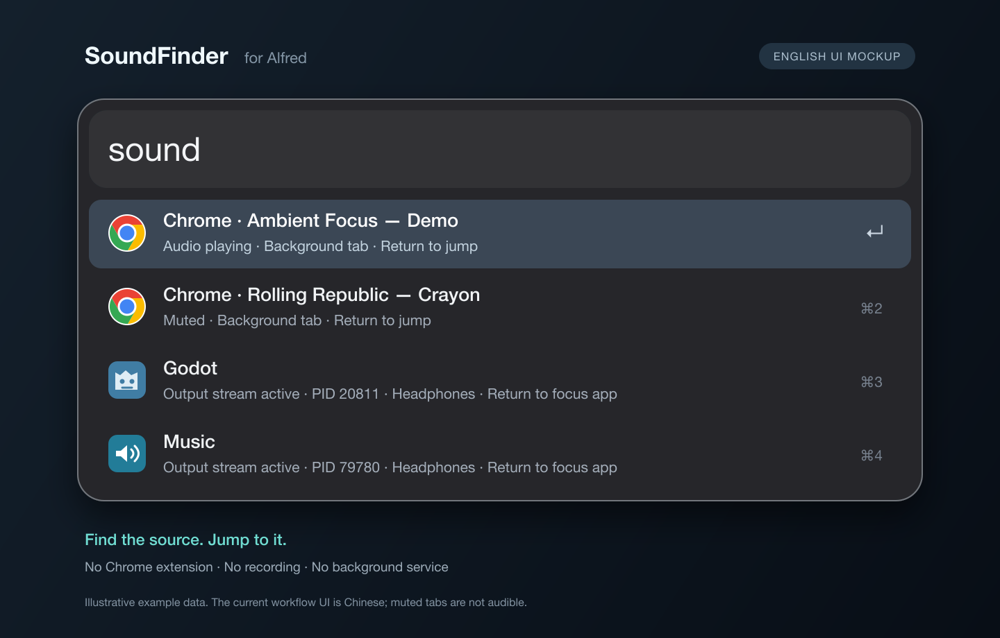

# SoundFinder for Alfred

**English** | [简体中文](README.zh-CN.md)


**Find the app—or Chrome tab—behind the sound on your Mac.**

SoundFinder is an Alfred workflow written in Swift. Type `sound` in Alfred to
find apps and processes with active audio output, identify Chrome tabs marked as
playing audio, and jump to the source. No Chrome extension, remote debugging,
or background service is required.



*Illustrative English UI mockup with example data, not a live screenshot.
The current workflow interface remains in Simplified Chinese.*

## Features

- **App and process detection:** query active output streams through Core Audio,
  showing app names, the PIDs of the actual audio processes, and output devices.
- **Chrome tab detection:** read native Accessibility audio markers to distinguish
  playing and muted tabs, including ordinary background tabs.
- **Jump to the source:** press Return to focus an existing app or the original
  tab, without reopening the page. Targets are checked again before activation.
- **Live filtering:** results refresh every two seconds while open and can be
  filtered by app, process, PID, device, or tab title.
- **Local operation:** no recording, audio sampling, network requests, or browser
  history access. The workflow never automatically pauses or closes content.

> An active output stream does not necessarily mean audible sound. An app may keep
> its audio channel open or output silent data. Muted Chrome tabs are labeled
> separately and are not treated as currently audible.

## Requirements

| Component | Requirement |
| --- | --- |
| System | macOS 14.4 or later |
| Alfred | Alfred 5 with Powerpack |
| Chrome tab detection | Google Chrome with an English interface; macOS Accessibility permission |
| Building from source | Swift 5.9+, Xcode or Command Line Tools, and Python 3 |

Built and tested on macOS 26.7 / Apple Silicon. The build script produces a binary
for the local machine's architecture; Intel Mac compatibility has not been tested.
The workflow package contains the compiled executable,
so **Swift, Python, and Xcode are not needed to run an installed workflow**.

Documentation is available in English and Simplified Chinese. The current
workflow interface and messages remain in Simplified Chinese; Chrome audio-state
detection still supports English markers only.

## Installation

This repository contains source code and packaging scripts. Workflow packages
are generated locally and are not committed to Git.

```sh
git clone https://github.com/lionoggo/soundfinder-alfred.git
cd soundfinder-alfred
bash scripts/build.sh
open dist/SoundFinder-1.1.2.alfredworkflow
```

Confirm installation or update of “声音来源 · SoundFinder” in Alfred's import
dialog. The script runs tests before creating a locally ad-hoc-signed package.
It does not automatically modify installed workflows, notarize the executable,
or publish a GitHub release.

## Usage

Open Alfred and type `sound`. Add a space after the keyword if needed.

| Action | Result |
| --- | --- |
| `sound` | List Chrome playing/muted tabs and apps/processes with active audio output |
| `sound chrome` | Filter Chrome-related results |
| `sound headphones` | Filter apps/processes by a matching output device name |
| `sound 1234` | Filter by audio process PID |
| `sound video title` | Filter by a matching Chrome tab title |
| Return | Hide Alfred, then focus the existing app or original tab |
| `⌘C` | Copy source details |
| `⌘L` | Show source information in large type |

Browser audio helpers are grouped under their parent app; copied details retain
each actual audio process's PID. Background processes that cannot be attributed
to an activatable app can be inspected and copied, but are never terminated.

### Chrome Accessibility permission

If you see “授权 Chrome 标签页检测” (authorize Chrome tab detection), select it
and press Return to open:

**System Settings → Privacy & Security → Accessibility**

Allow Alfred or soundfinder as prompted by macOS, then run `sound` again.
Opening the results list alone does not trigger a permission request. Permission
granted to a terminal does not necessarily cover a process launched by Alfred;
follow the prompt in the environment where you run the workflow.

App and process detection still works without Accessibility permission.
Microphone, Screen Recording, AppleScript automation, “Allow JavaScript from Apple
Events,” and Chrome debugging permissions are not required.

### Disable Chrome detection

Uncheck “启用 Chrome 发声标签页检测” (enable Chrome audio tab detection) in the
workflow's configuration to keep only app and process detection. There is no need
to downgrade to an older version.

For command-line use, you can also set:

```sh
soundfinder_chrome_ax=0 .build/release/soundfinder alfred
```

## How it works

**App detection** queries Core Audio process objects and output state, then uses
executable paths to identify the owning app. Read failures or exited sources
produce warnings rather than being interpreted as “no sound.”

**Chrome detection** walks only native tab-strip controls, skipping page content
and toolbars. It recognizes `Audio playing` / `Audio muted` in Accessibility
labels, without an extension or page-script execution. Results show tab titles;
tab URLs are not guaranteed to be available.

**Activation** rescans and checks the process, tab-strip position, title, and audio
state. Changed targets, duplicate audio-tab titles, or incomplete reads cause a
refresh prompt instead of a guessed selection. After requesting app activation,
the workflow waits and checks the actual frontmost process rather than treating
“request sent” as success.

## Privacy and known limitations

At runtime, SoundFinder does not upload data, read cookies or browser history,
record or sample audio, change system volume, or create background services.
Windows are only focused after you explicitly select a result and press Return;
detection itself does not activate windows or expand tab groups.

- App output streams can contain silent data and cannot measure actual volume.
- Chrome audio markers take a short time to clear; brief notification sounds may
  occur between scans and be missed.
- Only English Chrome markers are implemented and tested. Other interface
  languages are not supported yet; other browsers have app-level detection only.
- Collapsed, hidden, or minimized windows, multiple profiles, and special windows
  have not been exhaustively tested; results may be incomplete.
- Changing titles or tab-strip structure may require reselection. Same-named
  audio tabs in one Chrome process may prevent a jump.
- Accessibility label parsing is not a security boundary. Page titles that
  intentionally imitate marker suffixes can cause false positives, so the tool
  never automatically closes, mutes, or performs other destructive actions.
- Playback history is not recorded. Windowless system services or command-line
  players may not be possible to bring to the foreground.

See the [Chrome Accessibility validation report](docs/chrome-ax-validation.md)
(Chinese) for observed behavior and scenarios that remain unverified.

## Development and testing

```sh
# Build, test, sign, and package
bash scripts/build.sh

# Run Swift unit tests only
swift test

# App/process JSON
.build/release/soundfinder list

# Chrome playing/muted tab JSON, permission state, and scan warnings
.build/release/soundfinder chrome-list

# Alfred Script Filter JSON
.build/release/soundfinder alfred chrome

# Check the actual workflow package's connections, Return behavior, and arguments
python3 scripts/test_workflow.py dist/SoundFinder-1.1.2.alfredworkflow

# Verify real output start/stop with zero PCM data and a player set to volume 0
swift scripts/smoke_audio.swift ./dist/SoundFinder/soundfinder
```

Tests cover audio process attribution, browser helper grouping, filtering, Chrome
marker parsing, activation arguments, permission fallback, asynchronous
activation, default icons, package connections, icon files, and bilingual docs.

`scripts/probe_chrome_ax.swift` is a development diagnostic that prints metadata
for all native tabs. **Do not share its full output publicly.**
`Tests/fixtures/` contains manual test pages that do not play audio by default.
The nonzero-signal button produces a -60 dBFS signal and stops after 120 seconds.
Test programs do not modify other players or system volume.

### Project structure

```text
Sources/
  SoundFinder/          Command-line entry point
  SoundFinderCore/      Core Audio, Chrome Accessibility, and Alfred output
Tests/
  SoundFinderCoreTests/ Swift unit tests
  fixtures/            Manual test pages
scripts/               Build, packaging, and integration checks
assets/                Editable SVG icon and export notes
icon.png               Workflow and default result icon
README.md              English documentation
README.zh-CN.md        Chinese documentation
docs/                  Validation records
dist/                  Locally generated packages, not tracked in Git
```

## Version and troubleshooting

The current version is **v1.1.2**, which adds the identity icon and icons for
background processes, empty results, permission prompts, and errors.
App and Chrome tab results keep their application icons.
See [assets](assets/README.md) (Chinese) for the icon source and export notes.

- **Return leaves you in Alfred:** install v1.1.1 or later. That version fixes the
  connection's incorrect “Don't close Alfred” setting and verifies the actual
  frontmost process.
- **Chrome appears as an app but no tabs are listed:** check Accessibility
  permission, the Chrome detection checkbox, and whether Chrome uses an English
  interface. An active app output stream may also just contain silent data.
- **The target changed or results are incomplete:** run `sound` again; do not
  force reuse of stale results.

Versions v1.0 and v1.1.0 contain the connection setting issue that leaves Alfred
open. Do not downgrade just to disable Chrome detection.

## Uninstall

Remove “声音来源 · SoundFinder” from Alfred Preferences → Workflows.
There are no background services to uninstall or browser settings to restore.
Accessibility permission granted specifically for the workflow can be revoked
in System Settings.

## Maintainer

[lionoggo](https://github.com/lionoggo)
